<a id="readme-top"></a>

<div align="center">


<br />

&nbsp;&nbsp;&nbsp;
&nbsp;&nbsp;&nbsp;
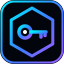

<h1>OMEGA NEX-ORA</h1>

<p>
  <strong>NexOra Database Key Generator · Universal Key Management Platform</strong><br />
  <em>Secure Keys. Smarter Database Management.</em>
</p>

<p><sub><strong>ADMIN-ONLY CONTROL PLANE · PROJECT LIFECYCLE · READER AUTHORIZATION</strong></sub></p>

<p>
  
  
  
  
</p>
<p>
  
  
  
  
</p>

<p>
  <a href="#overview"><strong>Overview</strong></a> ·
  <a href="#feature-highlights"><strong>Features</strong></a> ·
  <a href="#quick-start"><strong>Quick Start</strong></a> ·
  <a href="#flowchart-atlas"><strong>Flowcharts</strong></a> ·
  <a href="#architecture"><strong>Architecture</strong></a> ·
  <a href="#key-management"><strong>Keys</strong></a> ·
  <a href="#reader-integration"><strong>Reader</strong></a> ·
  <a href="#rest-api-reference"><strong>API</strong></a> ·
  <a href="#security"><strong>Security</strong></a> ·
  <a href="#visual-identity-and-assets"><strong>Assets</strong></a> ·
  <a href="#deployment-and-operations"><strong>Deploy</strong></a> ·
  <a href="#roadmap"><strong>Roadmap</strong></a>
</p>

</div>

<table align="center">
  <tr>
    <td align="center">🌌<br /><sub><b>ONE PLATFORM</b><br />INFINITE POSSIBILITIES</sub></td>
    <td align="center">🔐<br /><sub><b>SECURE</b><br />AUTHORIZATION</sub></td>
    <td align="center">🗂️<br /><sub><b>UNIVERSAL</b><br />PROJECT MANAGEMENT</sub></td>
    <td align="center">♾️<br /><sub><b>UNLIMITED</b><br />KEY GENERATION*</sub></td>
    <td align="center">⚙️<br /><sub><b>ADVANCED</b><br />DATABASE CONTROL</sub></td>
  </tr>
</table>

<p align="center"><sub>* Unlimited by design: the platform imposes no arbitrary project or key limits, so capacity is bounded only by infrastructure, policy, and configuration.</sub></p>

<p align="center">
  <strong>CONTROL PLANE</strong> &nbsp;·&nbsp; <strong>KEY FORGE</strong> &nbsp;·&nbsp; <strong>POLICY ENGINE</strong> &nbsp;·&nbsp; <strong>SECURE API</strong> &nbsp;·&nbsp; <strong>AUDIT TRAIL</strong>
</p>

<p align="center"><sub>Documentation-first project overview · GitHub-native diagrams · Security-conscious integration boundaries</sub></p>

<table align="center">
  <tr>
    <td align="center"><h3>11</h3><sub>SQL migrations<br />(001–011)</sub></td>
    <td align="center"><h3>20</h3><sub>built-in<br />key types</sub></td>
    <td align="center"><h3>22</h3><sub>platform console<br />views</sub></td>
    <td align="center"><h3>11</h3><sub>viewports in the<br />responsive audit</sub></td>
    <td align="center"><h3>282</h3><sub>tests passed<br />(documented)</sub></td>
  </tr>
</table>

<p align="center"></p>

<details>
<summary><b>📖 Full table of contents</b></summary>

1. [Overview](#overview) · [What is OMEGA NEX-ORA?](#what-is-omega-nex-ora) · [Project Identity](#project-identity) · [The NexOra Concept](#the-nexora-concept) · [Vision and Mission](#vision-and-mission) · [Core Philosophy](#core-philosophy)
2. [Feature Highlights](#feature-highlights) · [Core Platform Capabilities](#core-platform-capabilities)
3. [Quick Start](#quick-start) · [Prerequisites](#prerequisites) · [Install and Run](#install-and-run)
4. [Flowchart Atlas](#flowchart-atlas)
5. [Architecture](#architecture) · [Repository Boundary](#repository-boundary) · [System Architecture](#system-architecture) · [System Layers](#system-layers) · [Architectural Principles](#architectural-principles) · [Platform Systems](#platform-systems) · [Universal Navigation](#universal-navigation)
6. [Project Management](#project-management) · [Project Capabilities](#project-capabilities) · [Project Configuration](#project-configuration) · [Project Lifecycle](#project-lifecycle)
7. [Key Management](#key-management) · [Key Operations and Properties](#key-operations-and-properties) · [Universal Key Architecture](#universal-key-architecture) · [Key Types](#key-types) · [Key Forge: Key Generation Engine](#key-forge-key-generation-engine) · [Key Lifecycle](#key-lifecycle) · [Expiration and Permanent Authorization](#expiration-and-permanent-authorization) · [Key Revocation and Permanent Deletion](#key-revocation-and-permanent-deletion)
8. [Validation and Authorization](#validation-and-authorization) · [Validation Engine](#validation-engine) · [Authorization Engine](#authorization-engine) · [Permission System](#permission-system) · [Project Isolation](#project-isolation)
9. [Reader Integration](#reader-integration) · [Project and Reader-Key Lifecycle](#project-and-reader-key-lifecycle) · [Reader Activation Flow](#reader-activation-flow) · [Reader Integration Contract](#reader-integration-contract) · [Deletion Safety](#deletion-safety)
10. [REST API Reference](#rest-api-reference) · [API Design and Integration](#api-design-and-integration)
11. [Automation and Data Operations](#automation-and-data-operations) · [Scheduled Cleanup and Automation](#scheduled-cleanup-and-automation) · [Backup, Import and Replacement](#backup-import-and-replacement) · [Signed Webhooks](#signed-webhooks)
12. [Database and Migrations](#database-and-migrations) · [Database Architecture](#database-architecture) · [Database Integrity](#database-integrity) · [Migrations](#migrations)
13. [Security](#security) · [Security Model](#security-model) · [Secret-Handling Rules](#secret-handling-rules) · [Security Principles](#security-principles) · [Authentication and Authorization](#authentication-and-authorization) · [Data Protection and Rate Limiting](#data-protection-and-rate-limiting) · [Error Handling, Logging and Monitoring](#error-handling-logging-and-monitoring)
14. [Admin Dashboard and UX](#admin-dashboard-and-ux) · [Administrative Dashboard](#administrative-dashboard) · [Universal Management Interface](#universal-management-interface) · [Interface and Experience](#interface-and-experience) · [Animation System](#animation-system)
15. [Visual Identity and Assets](#visual-identity-and-assets) · [Effect: Hero Visuals](#effect-hero-visuals) · [Branding Set](#branding-set) · [OMEGA KEY Asset Kit](#omega-key-asset-kit) · [Using the Assets](#using-the-assets) · [Complete Asset Index](#complete-asset-index)
16. [Configuration](#configuration) · [Environment Variables](#environment-variables) · [Technology Stack](#technology-stack) · [System Requirements](#system-requirements)
17. [Repository Layout](#repository-layout)
18. [Testing and Quality](#testing-and-quality) · [Test Results](#test-results) · [Test Areas](#test-areas) · [Quality Requirements](#quality-requirements)
19. [Deployment and Operations](#deployment-and-operations) · [Deployment Workflow](#deployment-workflow) · [Production Configuration](#production-configuration) · [Backup and Recovery](#backup-and-recovery) · [Performance and Scalability](#performance-and-scalability) · [Compatibility](#compatibility) · [Operational Checklist](#operational-checklist)
20. [Troubleshooting and FAQ](#troubleshooting-and-faq) · [Troubleshooting](#troubleshooting) · [Frequently Asked Questions](#frequently-asked-questions)
21. [Roadmap](#roadmap) · [Development Phases](#development-phases) · [Future Vision](#future-vision)
22. [Governance and Policy](#governance-and-policy) · [Owner-Controlled Repository Policy](#owner-controlled-repository-policy) · [Contributing](#contributing) · [Security Reporting](#security-reporting) · [Project Governance](#project-governance)
23. [Known Boundaries](#known-boundaries)
24. [Legal](#legal) · [Third-Party Notices](#third-party-notices) · [License](#license) · [Acknowledgements](#acknowledgements)

</details>

<p align="center"></p>

## Overview

<p align="center">
  
</p>

### What is OMEGA NEX-ORA?

**OMEGA NEX-ORA**, the **NexOra Database Key Generator**, is a universal, database-driven key-management and project-authorization platform. It simplifies the creation, management, validation, monitoring, and control of multiple authorization key types across multiple independent projects.

It brings key management, project management, authorization policies, expiration controls, database operations, and administrative workflows into one unified ecosystem. Instead of building a separate key system for every application, administrators manage every project and key from **one centralized platform**, where each key type operates inside its own capabilities, permissions, policies, and validation rules.

The documented responsibilities of this repository include project creation, one-time Reader Key generation and redemption, installation and device-credential management, administrative controls, audit history, and versioned REST APIs.

The documented backend uses a **Flask** application and **Supabase PostgreSQL**. The Admin dashboard is an **HTML5, vanilla JavaScript, and CSS** interface. A separate **Android Reader App** connects through the Reader API and is **not** part of this repository.

The repository also contains the **OMEGA NEX-ORA Universal Key Platform** (`/platform`): universal projects, key types, permission and scope ceilings, device bindings, API usage, signed webhooks, notifications, automation, import/export, platform roles, and audit correlation. See [`docs/UNIVERSAL_PLATFORM_GUIDE.md`](docs/UNIVERSAL_PLATFORM_GUIDE.md) and the delivery report [`docs/UNIVERSAL_PLATFORM_REPORT.md`](docs/UNIVERSAL_PLATFORM_REPORT.md).

### Project Identity

| Property | Value |
|---|---|
| **Project name** | OMEGA NEX-ORA (NexOra) |
| **Full name** | NexOra Database Key Generator |
| **Category** | Key Management Platform: Project and Reader Key Management |
| **Architecture** | Universal / Modular |
| **Backend** | Python / Flask |
| **Database** | PostgreSQL / Supabase |
| **Interface** | Web-based administrative platform (HTML5 · vanilla JavaScript · CSS) |
| **Primary purpose** | Project and key management |
| **Key management** | Multiple independent key types (20 built-in plus custom types) |
| **Project management** | Centralized |
| **Expiration** | Custom and permanent |
| **Deployment** | Configurable |
| **Repository** | `NexOra-Database-key-Gen` |
| **Builder / rights holder** | Shajeduzzaman Enan |
| **License** | OMEGA NEX-ORA Proprietary Software and Content License |

> [!NOTE]
> This README describes the repository's documented design and recorded verification results. It is not a substitute for inspecting the current source tree, running the test suite, validating migrations, or reviewing the deployed environment.

### The NexOra Concept

#### Flowchart 01: The NexOra Concept

*Three systems (Project, Key, Admin) share one database engine that serves external applications.*

<p align="center">
  
</p>

<sub>Editable Mermaid source: [ diagram-01.mmd ](./assets/readme-diagrams/source/diagram-01.mmd)</sub>

### Vision and Mission

> **Vision:** create a universal key-management ecosystem that lets developers and administrators manage every supported authorization key and project through one centralized, secure, scalable, and extensible platform.

**Mission:** simplify authorization management · eliminate unnecessary platform separation · provide universal project management · introduce independent key-type systems · improve database management · provide flexible expiration policies · improve authorization reliability · build a secure foundation for application integrations · stay extensible for future technologies.

### Core Philosophy

| Principle | What it means |
|---|---|
| **Universal management** | One platform provides access to all supported management operations. |
| **Separation of capabilities** | Different key types must not automatically share capabilities. |
| **Project independence** | Projects keep independent policies and authorization boundaries. |
| **Unlimited scalability by design** | No arbitrary project or key creation limits unless required by infrastructure, policy, or configuration. |
| **Secure by architecture** | Security lives in backend logic, database constraints, and authorization policies. |
| **Flexible expiration** | Projects and keys support temporary and permanent authorization. |
| **Administrative control** | Administrators keep centralized control over the system. |
| **Extensibility** | New key types and integrations arrive without a complete architectural rewrite. |

<p align="center"></p>

## Feature Highlights

<table>
  <tr>
    <td align="center" valign="top" width="33%">
      <br />
      <b>Universal Projects</b><br />
      <sub>Independent project inventory with its own policy, status, type, and expiration. Archive, export, import, and delete with guardrails.</sub>
    </td>
    <td align="center" valign="top" width="33%">
      <br />
      <b>Multiple Key Types</b><br />
      <sub>20 built-in key types plus custom types, each with permission and scope ceilings that requested keys can never exceed.</sub>
    </td>
    <td align="center" valign="top" width="33%">
      <br />
      <b>One-Time Reader Keys</b><br />
      <sub>Plaintext is shown once, only the HMAC digest is stored, and redemption moves a key from <code>GENERATED</code> to <code>USED</code>.</sub>
    </td>
  </tr>
  <tr>
    <td align="center" valign="top">
      <br />
      <b>Backend as Trust Boundary</b><br />
      <sub>Argon2id, hashed sessions, CSRF protection, rate limits, and deny-by-default Row Level Security.</sub>
    </td>
    <td align="center" valign="top">
      <br />
      <b>Expiration and Automation</b><br />
      <sub>Temporary or permanent policies, scheduled project purge, expired-session pruning, and a lock-protected scheduler.</sub>
    </td>
    <td align="center" valign="top">
      <br />
      <b>Devices and Installations</b><br />
      <sub>Device registry, bearer device credentials, heartbeat and status checks, and hard revocation of bindings.</sub>
    </td>
  </tr>
  <tr>
    <td align="center" valign="top">
      <br />
      <b>Database-First Design</b><br />
      <sub>Transactional lifecycle operations, forward-only migrations, deny-by-default policies, and a documented ER model.</sub>
    </td>
    <td align="center" valign="top">
      <br />
      <b>Backup, Import and Export</b><br />
      <sub>JSON or ZIP project bundles, validation without writing, conflict policies, and transactional restore.</sub>
    </td>
    <td align="center" valign="top">
      <br />
      <b>Audit and Role-Based Access</b><br />
      <sub>Audit history with request correlation, platform roles, custom roles, project-scoped roles, and anti-escalation guards.</sub>
    </td>
  </tr>
</table>

### Core Platform Capabilities

<table>
  <tr>
    <th>Universal management</th>
    <th>Project management</th>
    <th>Key management</th>
    <th>Security</th>
  </tr>
  <tr>
    <td valign="top">
      <ul>
        <li>Centralized project management</li>
        <li>Centralized key management</li>
        <li>Multiple key types</li>
        <li>Unified dashboard</li>
        <li>Shared configuration</li>
        <li>Shared database infrastructure</li>
        <li>Unified administrative workflow</li>
      </ul>
    </td>
    <td valign="top">
      <ul>
        <li>Project creation</li>
        <li>Project editing</li>
        <li>Project deletion</li>
        <li>Project archival</li>
        <li>Project restoration</li>
        <li>Project expiration</li>
        <li>Permanent projects</li>
        <li>Project configuration</li>
        <li>Project statistics</li>
      </ul>
    </td>
    <td valign="top">
      <ul>
        <li>Key generation</li>
        <li>Key type selection</li>
        <li>Key expiration</li>
        <li>Permanent keys</li>
        <li>Key validation</li>
        <li>Key revocation</li>
        <li>Key deletion</li>
        <li>Key search</li>
        <li>Key filtering</li>
      </ul>
    </td>
    <td valign="top">
      <ul>
        <li>Server-side validation</li>
        <li>Project isolation</li>
        <li>Key-type isolation</li>
        <li>Permission enforcement</li>
        <li>Secure database access</li>
        <li>Authentication</li>
        <li>Rate limiting</li>
      </ul>
    </td>
  </tr>
</table>

<p align="center"></p>

## Quick Start

### Prerequisites

| Requirement | Notes |
|---|---|
| **Operating system** | Windows, Linux, or macOS |
| **Runtime** | A compatible Python version and Git |
| **Database** | A PostgreSQL-compatible database (Supabase PostgreSQL is documented) |
| **Editor** | VS Code recommended |
| **Browser** | A modern desktop or mobile browser |

### Install and Run

**1. Clone and enter the repository**

```bash
git clone https://github.com/shajeduzzamanenan992008inc/NexOra-Database-key-Gen.git
cd NexOra-Database-key-Gen
```

**2. Create and activate a virtual environment**

```powershell
# Windows (PowerShell)
python -m venv .venv
.venv\Scripts\activate
```

```bash
# Linux / macOS
python3 -m venv .venv
source .venv/bin/activate
```

**3. Install dependencies**

```bash
pip install -r requirements.txt
```

> If your checkout manages dependencies with `pyproject.toml`, follow that configuration instead.

**4. Configure the environment**, then **migrate** and **run**

```bash
cp .env.example .env            # Windows: copy .env.example .env  (never commit the result)
python -m backend.cli migrate   # read the production migration gate first
python run.py                   # local development launcher
python -m pytest -v             # run the test suite
```

> [!IMPORTANT]
> Migrations **005–011** require an approved backup/PITR checkpoint and migration window before they touch production. See [Migrations](#migrations) and [Flowchart 23](#flowchart-23-deployment-workflow). Verify the real entry point and variable names against your checkout.

<p align="center"></p>

## Flowchart Atlas

Every flowchart, state diagram, sequence diagram, and ER diagram in this README is listed below. Each one lives next to the topic it explains. For reliable GitHub display, the diagrams are embedded as repository-local SVG assets rather than relying on the GitHub Mermaid rich-display viewer. The editable Mermaid source for each diagram is linked below its SVG.

| # | Diagram | Type | Section | Origin |
|---|---|---|---|---|
| **01** | [The NexOra Concept](#flowchart-01-the-nexora-concept) | Flowchart | [Overview](#overview) | 12.md · redrawn from the text diagram |
| **02** | [Repository Boundary (Admin and Reader)](#flowchart-02-repository-boundary-admin-and-reader) | Flowchart | [Architecture](#architecture) | 12.md · redrawn from the text diagram |
| **03** | [System Architecture (Admin, Backend and Reader)](#flowchart-03-system-architecture-admin-backend-and-reader) | Flowchart | [Architecture](#architecture) | README |
| **04** | [High-Level Architecture](#flowchart-04-high-level-architecture) | Flowchart | [Architecture](#architecture) | 12.md |
| **05** | [Universal Navigation Map](#flowchart-05-universal-navigation-map) | Flowchart | [Architecture](#architecture) | 12.md · redrawn from the text tree |
| **06** | [Project Configuration Model](#flowchart-06-project-configuration-model) | Flowchart | [Project Management](#project-management) | 12.md · redrawn from the text tree |
| **07** | [Project Lifecycle](#flowchart-07-project-lifecycle) | State diagram | [Project Management](#project-management) | 12.md |
| **08** | [Universal Key Architecture](#flowchart-08-universal-key-architecture) | Flowchart | [Key Management](#key-management) | 12.md |
| **09** | [Key Generation Workflow](#flowchart-09-key-generation-workflow) | Flowchart | [Key Management](#key-management) | 12.md · redrawn from the text flow |
| **10** | [Key Lifecycle](#flowchart-10-key-lifecycle) | State diagram | [Key Management](#key-management) | 12.md |
| **11** | [Validation Workflow](#flowchart-11-validation-workflow) | Flowchart | [Validation and Authorization](#validation-and-authorization) | 12.md |
| **12** | [Authorization Decision](#flowchart-12-authorization-decision) | Flowchart | [Validation and Authorization](#validation-and-authorization) | New · from the 12.md authorization conditions |
| **13** | [Project and Reader-Key Lifecycle](#flowchart-13-project-and-reader-key-lifecycle) | Flowchart | [Reader Integration](#reader-integration) | New · from the README lifecycle steps |
| **14** | [Reader Key States](#flowchart-14-reader-key-states) | State diagram | [Reader Integration](#reader-integration) | New · from the README lifecycle |
| **15** | [Reader Activation Sequence](#flowchart-15-reader-activation-sequence) | Sequence diagram | [Reader Integration](#reader-integration) | New · from the README Reader API |
| **16** | [Deletion Safety](#flowchart-16-deletion-safety) | Flowchart | [Reader Integration](#reader-integration) | New · from the README deletion rules |
| **17** | [Management API Guard](#flowchart-17-management-api-guard) | Flowchart | [REST API Reference](#rest-api-reference) | New · from the README security model |
| **18** | [Scheduler Run](#flowchart-18-scheduler-run) | Flowchart | [Automation and Data Operations](#automation-and-data-operations) | New · from the README scheduler |
| **19** | [Backup, Import and Replacement](#flowchart-19-backup-import-and-replacement) | Flowchart | [Automation and Data Operations](#automation-and-data-operations) | New · from the README export/import API |
| **20** | [Webhook Target Checks](#flowchart-20-webhook-target-checks) | Flowchart | [Automation and Data Operations](#automation-and-data-operations) | New · from the README webhook controls |
| **21** | [Logical Data Model](#flowchart-21-logical-data-model) | ER diagram | [Database and Migrations](#database-and-migrations) | 12.md |
| **22** | [Core Management Workflow](#flowchart-22-core-management-workflow) | Flowchart | [Admin Dashboard and UX](#admin-dashboard-and-ux) | 12.md · redrawn from the text flow |
| **23** | [Deployment Workflow](#flowchart-23-deployment-workflow) | Flowchart | [Deployment and Operations](#deployment-and-operations) | 12.md + the README migration gate |

**23 diagrams in total:** architecture maps, project and key lifecycles, authorization decisions, Reader activation, deletion safety, API guards, automation, import/export, webhook validation, a conceptual ER model, and deployment workflow.

### GitHub Mermaid rendering standard

All diagrams use GitHub's native `mermaid` fenced-code renderer. They are intentionally kept as standalone Markdown code fences (not nested inside HTML tables, `<p>`, or layout containers) so GitHub can detect and render them.

- Use a fenced code block whose language identifier is `mermaid`; close it with the matching fence.
- Keep Mermaid source at the left margin; do not indent the fence inside lists or blockquotes.
- Prefer standard Mermaid declarations (`flowchart`, `stateDiagram-v2`, `sequenceDiagram`, and `erDiagram`) and quoted node labels.
- Avoid embedding Markdown tables or raw HTML around a Mermaid fence.
- When editing a diagram, validate the Mermaid source and preview the README on GitHub before merging.
- If a diagram appears as code after a commit, verify that the file is rendered as Markdown, that the fence language is exactly `mermaid`, and that the source has no unmatched quotes, brackets, or subgraph boundaries.

> [!TIP]
> GitHub renders Mermaid diagrams natively. No external image host, JavaScript embed, or generated screenshot is required. The diagrams remain text-based, reviewable, accessible to source-control diffs, and theme-adaptive in GitHub.


<p align="center"><a href="#readme-top">↑ Back to top</a></p>

<p align="center"></p>

## Architecture

OMEGA NEX-ORA is a layered platform in which the **Flask backend is the only trust boundary** for database credentials. The Admin dashboard and the external Reader App are both clients of the versioned REST API.

### Repository Boundary

| Area | Responsibility | Repository status described by the project documentation |
|---|---|---|
| Admin dashboard | Administrative user interface | Included in the Admin project |
| Flask backend | Authentication, business logic, Reader APIs | Documented as the trusted backend |
| Supabase PostgreSQL | Persistent project, key, installation, and audit data | External managed database |
| Android Reader App | One-time key redemption and authenticated reconnection | Separate project and repository |

> [!WARNING]
> The browser and the Reader App must **never** receive the Supabase service-role key or a direct PostgreSQL password. Database credentials belong only in the trusted backend environment.

#### Flowchart 02: Repository Boundary (Admin and Reader)

*The Reader Application is an independent project and must not be implemented inside the NexOra Admin repository.*

<p align="center">
  
</p>

<sub>Editable Mermaid source: [ diagram-02.mmd ](./assets/readme-diagrams/source/diagram-02.mmd)</sub>

### System Architecture

#### Flowchart 03: System Architecture (Admin, Backend and Reader)

*The documented control path from the Admin dashboard and the Reader App to Supabase PostgreSQL.*

<p align="center">
  
</p>

<sub>Editable Mermaid source: [ diagram-03.mmd ](./assets/readme-diagrams/source/diagram-03.mmd)</sub>

#### Flowchart 04: High-Level Architecture

*The logical engine layout: managers, policy and lifecycle engines, validation, and the database layer.*

<p align="center">
  
</p>

<sub>Editable Mermaid source: [ diagram-04.mmd ](./assets/readme-diagrams/source/diagram-04.mmd)</sub>

### System Layers

| Layer | Responsibility |
|---|---|
| **Presentation** | Provides the administrative interface. |
| **Application** | Coordinates application functionality. |
| **Business logic** | Implements key management, project policies, expiration, permissions, and validation. |
| **Database** | Provides persistent storage. |
| **Integration** | Provides API access to external applications. |
| **Security** | Enforces authentication, authorization, and data protection. |

### Architectural Principles

- **Backend as the trust boundary:** the Flask backend is the only layer documented as holding direct database credentials.
- **Fail-fast configuration:** required secrets and database settings are validated at startup.
- **Least exposure:** browser and Reader clients receive only the credentials and responses required by their API contract.
- **Transactional lifecycle operations:** project and Reader Key creation and deletion are documented as atomic operations.
- **Auditable administration:** privileged operations write administrative audit events.

### Platform Systems

NexOra consists of several interconnected systems.

| System | Responsibility |
|---|---|
| Universal Dashboard | Central overview |
| Project Manager | Project creation and control |
| Key Generator | Key creation |
| Key Manager | Key administration |
| License System | License authorization |
| Reader System | Reader authorization |
| Expiration Engine | Time-based authorization |
| Validation Engine | Key verification |
| Permission Engine | Capability control |
| Database Layer | Persistent storage |
| API Layer | External integration |
| Security Layer | Protection and access control |
| Animation System | UI effects |
| Configuration System | Platform settings |

### Universal Navigation

All management operations are reachable through one administrative interface.

#### Flowchart 05: Universal Navigation Map

*The conceptual navigation tree of the universal console.*

<p align="center">
  
</p>

<sub>Editable Mermaid source: [ diagram-05.mmd ](./assets/readme-diagrams/source/diagram-05.mmd)</sub>

<p align="center"></p>

## Project Management

Projects are the central organizational entities of NexOra. **Every key is associated with a valid project.**

### Project Capabilities

Create unlimited projects · configure projects independently · generate project-specific keys · manage project status · configure expiration · configure permanent status · view project statistics · manage project authorization.

### Project Configuration

#### Flowchart 06: Project Configuration Model

*Identity, status, expiration, key configuration, and policies of a project.*

<p align="center">
  
</p>

<sub>Editable Mermaid source: [ diagram-06.mmd ](./assets/readme-diagrams/source/diagram-06.mmd)</sub>

### Project Lifecycle

Projects follow a controlled lifecycle, and **project state must be enforced by the backend**.

#### Flowchart 07: Project Lifecycle

*State machine for a project from creation to permanent deletion.*

<p align="center">
  
</p>

<sub>Editable Mermaid source: [ diagram-07.mmd ](./assets/readme-diagrams/source/diagram-07.mmd)</sub>

> [!NOTE]
> The legacy dashboard API sets a project to `active` or `inactive` (`PATCH /projects/<id>/status`). Deactivating a project blocks new activations and existing device credentials. The universal platform adds archiving, which also blocks the project's keys. Project-level auto-delete is a timezone-aware deletion timestamp and stays disabled until a retention period or project schedule is configured.

<p align="center"></p>

## Key Management

The key-management system is the heart of NexOra.

### Key Operations and Properties

| Key operations | A key may contain |
|---|---|
| Generate · View · Search · Filter · Validate · Revoke · Delete · Configure · Manage expiration | Unique identifier · key type · project association · authorization status · expiration · creation timestamp · configuration · permissions · metadata |

### Universal Key Architecture

All key types share one management foundation while keeping independent capabilities. **A shared foundation never implies shared permissions.**

#### Flowchart 08: Universal Key Architecture

*Every key type is governed by its own policy before the shared validation engine returns a result.*

<p align="center">
  
</p>

<sub>Editable Mermaid source: [ diagram-08.mmd ](./assets/readme-diagrams/source/diagram-08.mmd)</sub>

### Key Types

Each type has a unique identifier and an independent policy configuration. The platform ships with **20 built-in key types** and supports custom key types through the universal key-type API.

<table>
  <tr>
    <td align="center" width="25%">
      <br />
      <b>License Key</b><br />
      <sub>Application licensing and authorization<br />(cyan family)</sub>
    </td>
    <td align="center" width="25%">
      <br />
      <b>Reader Key</b><br />
      <sub>Authorization for Reader applications<br />(violet family)</sub>
    </td>
    <td align="center" width="25%">
      <br />
      <b>Custom / Other Key</b><br />
      <sub>Extensible authorization category<br />(amber family)</sub>
    </td>
    <td align="center" width="25%">
      <br />
      <b>Database Key</b><br />
      <sub>Database key family<br />(green family)</sub>
    </td>
  </tr>
</table>

<details>
<summary><b>License Key System</b></summary>

**Purpose:** License Keys represent application licensing authorization.

**Intended capabilities:** license generation · management · expiration · status · validation · revocation · project association.

**License statuses:** Active · Expired · Revoked · Invalid.

License-specific policies are enforced independently of every other key type.

</details>

<details>
<summary><b>Reader Key System</b></summary>

**Purpose:** Reader Keys authorize applications that implement the Reader authorization system.

**Intended capabilities:** Reader key generation · Reader-specific validation · Reader status · Reader expiration · Reader revocation · project association.

Reader Keys must **not** automatically inherit License Key capabilities. The one-time redemption flow is described in [Reader Integration](#reader-integration).

</details>

<details>
<summary><b>Custom Key Types</b></summary>

NexOra is extensible. Future key types may include **Application Keys · Integration Keys · Service Keys · Device Authorization Keys · Temporary Access Keys · Development Keys**.

New types are introduced through a defined architecture (`POST /universal/key-types`), never through arbitrary database modifications.

</details>

### Key Forge: Key Generation Engine

<table>
  <tr>
    <td align="center" width="30%">
      <br />
      <sub><b>OMEGA · ULTRA UNIVERSAL KEY GEN</b></sub>
    </td>
    <td valign="top">
      The key-generation engine creates valid key records. It requires:
      <ul>
        <li><b>Secure randomness</b> (CSPRNG) and <b>unique identifiers</b></li>
        <li><b>Key-type awareness</b> and <b>project association</b></li>
        <li><b>Expiration configuration</b> and <b>validation compatibility</b></li>
        <li><b>Collision handling</b> and <b>database integrity</b></li>
      </ul>
      Plaintext secrets are revealed <b>only once</b>, in the creation or rotation response; only digests are stored.
    </td>
  </tr>
</table>

#### Flowchart 09: Key Generation Workflow

*A generation request must pass project, key-type, and policy validation before a key is created and stored.*

<p align="center">
  
</p>

<sub>Editable Mermaid source: [ diagram-09.mmd ](./assets/readme-diagrams/source/diagram-09.mmd)</sub>

<table align="center">
  <tr>
    <td align="center"><br /><sub><b>Forging</b><br /><code>key-generating.svg</code></sub></td>
    <td align="center"><b>→</b></td>
    <td align="center"><br /><sub><b>Verified</b><br /><code>key-verified.svg</code></sub></td>
  </tr>
</table>

### Key Lifecycle

#### Flowchart 10: Key Lifecycle

*Invalid, expired, revoked, and deleted keys are never authorized.*

<p align="center">
  
</p>

<sub>Editable Mermaid source: [ diagram-10.mmd ](./assets/readme-diagrams/source/diagram-10.mmd)</sub>

**Lifecycle requirements**

- Invalid states must not be authorized.
- Expiration must be enforced.
- Revocation must be immediate from the authoritative system.
- Deleted keys must not be restored through normal authorization.
- Project status must be checked.
- Permissions must be checked.

### Expiration and Permanent Authorization

NexOra supports **project-level** expiration (does the project remain authorized?) and **key-level** expiration (does this individual key remain authorized?).

| Expiration rules | Permanent authorization |
|---|---|
| Expiration is checked **server-side** · expired keys are rejected · expired projects block authorization · never-expiring policies must be **explicit** · timezone handling is consistent · expiration updates are persisted | A **permanent project** has no expiration deadline and a **permanent key** has no expiration deadline. Permanence does **not** bypass project suspension, key revocation, permission restrictions, security policies, or administrative controls. |

### Key Revocation and Permanent Deletion

| Revocation disables authorization | Permanent deletion removes the key from the authoritative database |
|---|---|
| Authorized administrative operation · server-side enforcement · immediate status update · validation rejection · cache invalidation where applicable · consistent database state | Authorized deletion · database consistency · proper transaction handling · no active authorization afterwards · associated data handled consistently · no accidental restoration through stale caches |

<p align="center"></p>

## Validation and Authorization

### Validation Engine

The validation engine decides whether a key is authorized. It checks: **key existence · key type · project association · project status · project expiration · key status · key expiration · permissions · policy compliance**.

#### Flowchart 11: Validation Workflow

*The ordered checks applied to every validation request.*

<p align="center">
  
</p>

<sub>Editable Mermaid source: [ diagram-11.mmd ](./assets/readme-diagrams/source/diagram-11.mmd)</sub>

### Authorization Engine

Authorization is based on the **authoritative server-side state**. A key is authorized only when every applicable condition holds.

#### Flowchart 12: Authorization Decision

*All nine conditions must pass. If any one fails, the key is not authorized.*

<p align="center">
  
</p>

<sub>Editable Mermaid source: [ diagram-12.mmd ](./assets/readme-diagrams/source/diagram-12.mmd)</sub>

### Permission System

Permissions are **isolated by key type**. A key may only perform operations explicitly allowed by its type and policy.

| Permission categories | Platform enforcement |
|---|---|
| Project access · License authorization · Reader authorization · Key administration · API access · Administrative operations | **Universal key-type ceilings** reject requested permissions or scopes broader than the key type allows. **Server-side platform RBAC** requires a human session plus an explicit platform permission for management APIs. Custom roles, project-scoped roles, and anti-escalation guards are documented in [`docs/CUSTOM_ROLES.md`](docs/CUSTOM_ROLES.md). |

### Project Isolation

Project isolation is a core security requirement:

- Every key has project ownership.
- Project boundaries are enforced and cross-project authorization is rejected.
- Database operations respect project boundaries.
- API requests identify the correct project context.
- Administrative operations verify their permissions.

<p align="center"></p>

## Reader Integration

The Reader App is an **independent client** that uses only the public Reader API contract. It lives in its own repository and is never implemented inside this Admin project.

### Project and Reader-Key Lifecycle

1. An administrator opens **Key Generator** in the dashboard.
2. The administrator enters a project name and selects **Generate Key**.
3. The backend normalizes the project name case-insensitively and creates the project plus **exactly one Reader Key** in a single transaction.
4. Only the key's **HMAC digest** is stored. The plaintext key is returned once for copying.
5. A duplicate name, including a name retained in the deleted-name tombstone registry, returns `409` with safe metadata. The original plaintext key is never returned.
6. The separate Reader App redeems the key once through `POST /api/v1/reader/activate`; the documented state transition is `GENERATED` → `USED`.
7. Deactivating a project blocks new activations and existing device credentials without rewriting the Reader Key lifecycle state.
8. Deleting a project permanently removes the project and its owned key, installations, device tokens, and records in one transaction. The audit event survives, and the normalized project name is tombstoned.
9. **DELETE ALL PROJECTS** requires the exact confirmation phrase and a fresh password check. The documentation says admin accounts, settings, audit history, and legacy SMS data are preserved.

#### Flowchart 13: Project and Reader-Key Lifecycle

*From key generation to redemption, deactivation, and deletion.*

<p align="center">
  
</p>

<sub>Editable Mermaid source: [ diagram-13.mmd ](./assets/readme-diagrams/source/diagram-13.mmd)</sub>

#### Flowchart 14: Reader Key States

*Documented transition `GENERATED` → `USED`; revocation is permanent.*

<p align="center">
  
</p>

<sub>Editable Mermaid source: [ diagram-14.mmd ](./assets/readme-diagrams/source/diagram-14.mmd)</sub>

### Reader Activation Flow

#### Flowchart 15: Reader Activation Sequence

*One-time activation followed by authenticated heartbeat and status calls.*

<p align="center">
  
</p>

<sub>Editable Mermaid source: [ diagram-15.mmd ](./assets/readme-diagrams/source/diagram-15.mmd)</sub>

### Reader Integration Contract

- Activation **redeems a generated Reader Key once**.
- A successful activation returns the **device credential** used for subsequent authenticated requests.
- Heartbeat and status requests use a **Bearer device credential** over HTTPS.
- The Reader App must **not** embed server-side secrets, a Supabase service-role key, or a direct database password.
- The Reader App's own source code, release process, and Android-specific behavior are outside this repository's documented scope. See [Flowchart 02](#flowchart-02-repository-boundary-admin-and-reader).

### Deletion Safety

#### Flowchart 16: Deletion Safety

*Every destructive path demands explicit confirmation and keeps its audit trail.*

<p align="center">
  
</p>

<sub>Editable Mermaid source: [ diagram-16.mmd ](./assets/readme-diagrams/source/diagram-16.mmd)</sub>

<p align="center"></p>

## REST API Reference

**Base path:** `/api/v1/`

<details open>
<summary><b>Health and Authentication</b> · 4 routes</summary>


| Method | Endpoint | Purpose |
|---|---|---|
| `GET` | `/health` | Service and database connection health. |
| `POST` | `/auth/login` | Rate-limited Admin login; sets an HttpOnly session cookie. |
| `POST` | `/auth/logout` | Destroys the current session. |
| `GET` | `/auth/session` | Verifies the active session. |

</details>

<details>
<summary><b>Dashboard and Project Management</b> · 8 routes</summary>


| Method | Endpoint | Purpose |
|---|---|---|
| `GET` | `/dashboard/stats` | Aggregate project, key, installation, and database-health counters. |
| `POST` | `/projects/generate-key` | The documented sole project/key creation path; creates one project and one Reader Key atomically. |
| `GET` | `/projects` | Lists projects with key status, deletion schedule, remaining days, and installation status. |
| `GET` | `/projects/<id>` | Project details and installation overview. |
| `PATCH` | `/projects/<id>/status` | Sets `active` or `inactive`. |
| `PATCH` | `/projects/<id>/auto-delete` | Sets or clears the timezone-aware deletion timestamp. |
| `DELETE` | `/projects/<id>` | Permanently deletes one project and owned records; requires `confirm_project_name`. |
| `DELETE` | `/projects` | Deletes all NexOra projects transactionally; requires `confirmation: "DELETE ALL PROJECTS"` and current Admin password. |

</details>

<details>
<summary><b>Keys, Installations, Security, Audit and Settings</b> · 11 routes</summary>


| Method | Endpoint | Purpose |
|---|---|---|
| `GET` | `/keys` | Lists Reader Keys with search, project/status filters, and pagination. |
| `GET` | `/keys/<id>` | Key details without plaintext; hint only. |
| `GET` | `/keys/export` | Exports keys as CSV. |
| `POST` | `/keys/<id>/revoke` | Permanently revokes a Reader Key. |
| `GET` | `/installations` | Lists Reader installations with filters and pagination. |
| `GET` | `/installations/<id>` | Installation details and related audit events. |
| `POST` | `/installations/<id>/revoke` | Revokes an active Reader installation. |
| `GET` | `/security/status` | Authentication/session configuration, rate-limit information, and recent security events. |
| `GET` | `/audit-logs` | Paginated audit log with search, date, and event-type filters. |
| `GET` | `/settings` | Reads current system settings. |
| `PATCH` | `/settings` | Updates allowed settings such as key prefix, expiry, bulk limit, and heartbeat interval. |

</details>

<details>
<summary><b>Universal Platform API</b> · 40+ routes</summary>


These routes require a **human administrator session**, **CSRF protection**, and the permission noted in `backend/api/v1/universal.py`. The full route list and operational notes are in [`docs/UNIVERSAL_PLATFORM_GUIDE.md`](docs/UNIVERSAL_PLATFORM_GUIDE.md).

| Method | Endpoint | Purpose |
|---|---|---|
| `GET` | `/universal/overview` | Live platform counters and recent events. |
| `GET` | `/universal/projects` | Universal project inventory. |
| `PATCH` | `/universal/projects/<id>` | Update project metadata, type, status, or expiration. |
| `POST` | `/universal/projects/<id>/archive` | Archive project and block its keys. |
| `GET` | `/universal/key-types` | Key types plus the permission catalogue. |
| `POST` | `/universal/key-types` | Create a custom key type. |
| `GET` | `/universal/keys` | Filtered universal key inventory. |
| `POST` | `/universal/keys` | Generate one or more universal keys. |
| `GET` | `/universal/keys/<id>` | Key details and lifecycle events. |
| `POST` | `/universal/keys/<id>/revoke` | Hard-revoke a key and its active device bindings. |
| `GET` | `/universal/devices` | Device registry. |
| `GET` | `/universal/api-usage` | API usage telemetry. |
| `GET/POST` | `/universal/webhooks` | List/create signed webhooks. |
| `GET` | `/universal/notifications` | Notification center. |
| `GET` | `/universal/search` | Global search. |
| `POST` | `/universal/automation/run` | Run expiry/cleanup/retry automation. |
| `GET` | `/universal/automation/scheduler` | Scheduler status, queue depth, and recent runs. |
| `GET` | `/universal/projects/<id>/export/preview` | Project backup counts and security notice. |
| `GET` | `/universal/projects/<id>/export` | Export a JSON or ZIP project bundle. |
| `POST` | `/universal/projects/export` | Export selected or all projects as a ZIP/JSON collection. |
| `POST` | `/universal/projects/import/preview` | Validate a JSON/ZIP bundle without writing. |
| `POST` | `/universal/projects/import` | Transactional project restore with conflict policy. |
| `GET` | `/universal/projects/delete-preview` | Owner-only pre-deletion counts. |
| `DELETE` | `/universal/projects/<id>` | Permanent project deletion with name and password confirmation. |
| `DELETE` | `/universal/projects` | Owner-only delete-all with exact phrase and password. |
| `GET/POST` | `/universal/roles` | List or create custom platform roles. |
| `PATCH/DELETE` | `/universal/roles/<id>` | Update, clone, or delete a custom role. |
| `GET` | `/universal/imported-keys` | List imported key metadata. |
| `POST` | `/universal/imported-keys/replacement-preview` | Validate imported-key replacement eligibility. |
| `POST` | `/universal/imported-keys/replacements` | Generate independent replacement credentials with one-time reveal. |
| `GET` | `/universal/imported-keys/<id>/history` | Replacement history without plaintext. |
| `GET/POST` | `/universal/projects/<id>/role-assignments` | List or assign project-scoped roles. |
| `DELETE` | `/universal/projects/<id>/role-assignments/<assignment_id>` | Remove a project role assignment. |
| `GET` | `/universal/openapi.json` | OpenAPI document for the v1 surface. |
| `POST` | `/access/authenticate` | Authenticate a universal project key (no browser session). |

</details>

<details>
<summary><b>External Reader API</b> · 3 routes</summary>


| Method | Endpoint | Purpose |
|---|---|---|
| `POST` | `/reader/activate` | One-time activation using `project_name`, `reader_key`, `device_id`, and preferably `supabase_url`. |
| `POST` | `/reader/heartbeat` | Periodic heartbeat using `Authorization: Bearer <device_credential>`. |
| `GET` | `/reader/status` | Status check using `Authorization: Bearer <device_credential>`. |

The deprecated `database_url` activation field is documented as an alias for compatibility. It must contain the **Supabase Project URL**, not a PostgreSQL connection string.

</details>

### API Design and Integration

The API provides controlled access to NexOra functionality.

| API responsibilities | Integration principles |
|---|---|
| Request validation · project identification · key identification · authorization · permission verification · structured responses · error handling | Stable interface · consistent responses · secure transport · authentication · authorization · input validation · rate limiting · versioning |

#### Flowchart 17: Management API Guard

*Conceptual order of the documented controls on management routes, plus the separate key-authentication path.*

<p align="center">
  
</p>

<sub>Editable Mermaid source: [ diagram-17.mmd ](./assets/readme-diagrams/source/diagram-17.mmd)</sub>

<details>
<summary><b>Example authorization responses</b> (illustrative)</summary>

```json
{
  "success": true,
  "status": "authorized",
  "key_type": "license",
  "project_status": "active",
  "never_expires": true
}
```

```json
{
  "success": false,
  "status": "unauthorized",
  "reason": "invalid_or_inactive_key"
}
```

These examples are illustrative. The actual API response contract must be documented from the implementation; the live OpenAPI document is served at `/api/v1/universal/openapi.json`.

</details>

| NexOra is responsible for | External applications are responsible for |
|---|---|
| Maintaining project records · generating keys · validating keys · managing expiration · managing revocation · enforcing authorization | Submitting authorization requests · respecting authorization results · handling expiration · handling revocation · handling network failures appropriately |

<p align="center"></p>

## Automation and Data Operations

### Scheduled Cleanup and Automation

Automatic deletion remains **disabled** until an administrator configures a retention period (`auto_delete_days > 0`) and/or a project-level schedule.

The existing server-side cleanup command:

```bash
python -m backend.cli purge-expired-projects --limit 100
```

For universal automation, project purge, and expired-session pruning, run the standalone lock-protected scheduler:

```bash
python -m backend.cli universal-scheduler-run --once
python -m backend.cli universal-scheduler-run --once --dry-run
python -m backend.cli universal-scheduler-status
```

The Flask web process never runs an infinite scheduler loop. One worker at a time is protected by a PostgreSQL advisory lock; every sweep is bounded, recorded in `nexora_automation_runs`, and audited. Cron, systemd, Windows Task Scheduler, retry policy, monitoring, and failure recovery are documented in [`docs/SCHEDULER.md`](docs/SCHEDULER.md).

#### Flowchart 18: Scheduler Run

*A lock-protected, bounded sweep that is recorded and audited.*

<p align="center">
  
</p>

<sub>Editable Mermaid source: [ diagram-18.mmd ](./assets/readme-diagrams/source/diagram-18.mmd)</sub>

### Backup, Import and Replacement

Project backup, restore, conflict handling, and permanent deletion are documented in [`docs/PROJECT_BACKUP.md`](docs/PROJECT_BACKUP.md).

#### Flowchart 19: Backup, Import and Replacement

*Export previews, validation-only imports, transactional restore, and one-time reveal of replacement credentials.*

<p align="center">
  
</p>

<sub>Editable Mermaid source: [ diagram-19.mmd ](./assets/readme-diagrams/source/diagram-19.mmd)</sub>

### Signed Webhooks

Webhooks are signed, and the platform applies SSRF defenses: unsupported schemes, unresolved hosts, and private or link-local addresses are rejected. DNS pinning, redirect rejection, TLS controls, timeouts, and response bounds are covered by the tests; the controls are documented in [`docs/SECURITY_WEBHOOKS.md`](docs/SECURITY_WEBHOOKS.md). A webhook secret is revealed **only once**, in the creation or rotation response.

#### Flowchart 20: Webhook Target Checks

*Documented SSRF and delivery controls for signed webhooks.*

<p align="center">
  
</p>

<sub>Editable Mermaid source: [ diagram-20.mmd ](./assets/readme-diagrams/source/diagram-20.mmd)</sub>

<p align="center"></p>

## Database and Migrations

### Database Architecture

NexOra uses **PostgreSQL-compatible** infrastructure (Supabase PostgreSQL is the documented deployment, reached through a TLS connection pool). Setup needs a database instance, credentials, connection configuration, the required schema, and migration support.

| Database responsibilities | |
|---|---|
| Project storage · key storage · project policies | Key configuration · authorization state · expiration data · administrative metadata |

#### Flowchart 21: Logical Data Model

*Projects own keys, policies, and key metadata. The diagram describes the logical architecture and may not match the exact implemented schema; the migrations below are authoritative.*

<p align="center">
  
</p>

<sub>Editable Mermaid source: [ diagram-21.mmd ](./assets/readme-diagrams/source/diagram-21.mmd)</sub>

### Database Integrity

Database integrity is essential. The platform requires unique project identifiers · unique key identifiers · valid project associations · consistent status values · valid expiration values · appropriate foreign keys · appropriate indexes · transactional operations · migration compatibility.

### Migrations

The PostgreSQL schema is managed through `db/migrations/` and applied **in order**.

| Migration | Documented purpose |
|---|---|
| `001_initial_schema.sql` | `admin_users`, `admin_sessions`, `license_keys`, `key_activations`, `generation_logs`, `admin_audit_logs`. |
| `002_indexes_and_policies.sql` | Uniqueness constraints, performance indexes, and deny-by-default RLS policies. |
| `003_password_hash_comment.sql` | Documents the Argon2id password hashing standard. |
| `004_sms_reader_keys.sql` | Retains the legacy SMS Reader schema for compatibility. |
| `005_nexora_projects.sql` | Adds `nexora_projects`, `reader_keys`, `reader_installations`, `device_tokens`, and `system_settings`. |
| `006_rename_rh_function.sql` | Renames `rh_set_updated_at()` to `nexora_set_updated_at()` and repoints triggers. |
| `007_project_key_management.sql` | Adds the one-Reader-Key-per-project constraint, auto-delete metadata, deleted-name tombstones, supporting indexes, and RLS. |
| `008_multi_key_expiration.sql` | Adds multi-key expiration support without changing the one-key-per-project Reader contract. |
| `009_universal_key_platform.sql` | Adds universal project metadata, permission catalogue, 20 built-in key types, extended keys, devices, API usage, webhooks, notifications, automation, platform roles, audit request IDs, indexes, and RLS. |
| `010_project_transfer_roles_scheduler.sql` | Adds custom platform roles, imported key/device metadata, scheduler ledger fields, and project-transfer support indexes. |
| `011_project_roles_imported_replacements.sql` | Adds project-scoped roles, project role assignments, and imported-key replacement history. |

```bash
python -m backend.cli migrate
```

> [!CAUTION]
> **Production migration gate:** migrations **005–011** require an approved backup/PITR checkpoint and migration window. Do not apply them to production until that approval is complete. Migrations 009–011 were applied only to a dedicated local test database during this work.

**Migration principles:** maintain schema history · apply migrations in order · validate migrations · avoid destructive operations · preserve existing data where required · test migration compatibility.

<p align="center"></p>

## Security

Security is a foundational requirement and is enforced in backend logic, database constraints, and authorization policies.

### Security Model

The supplied documentation describes the following controls. Their presence in the deployed application must be verified against the full source code and live configuration.

| Control | Documented purpose |
|---|---|
| Argon2id password hashing | Protect the Super Admin password hash |
| Hashed admin sessions | Avoid storing raw session credentials |
| HttpOnly, Secure, SameSite cookies | Reduce browser-side session exposure |
| CSRF protection | Protect cookie-authenticated state-changing requests |
| Rate limiting | Reduce login and API abuse |
| CSPRNG key generation | Generate high-entropy Reader Keys |
| HMAC-SHA256 digests | Store key/token digests rather than plaintext secrets |
| Row Level Security | Deny database access by default unless explicitly allowed |
| Audit logs | Preserve records of privileged administrative events |
| Fail-closed Reader activation | Reject activation when required configuration is missing |
| Universal key-type ceilings | Reject requested permissions/scopes broader than the key type allows |
| Server-side platform RBAC | Require a human session and explicit platform permission for management APIs |
| Webhook SSRF checks | Reject unsupported schemes, unresolved hosts, and private/link-local addresses |
| One-time secret reveal | Return key/webhook plaintext only in the creation or rotation response |

### Secret-Handling Rules

> [!IMPORTANT]
> 1. Never commit `.env`, private keys, database passwords, service-role tokens, or production credentials.
> 2. Keep `SECRET_KEY` and `KEY_PEPPER` unique, randomly generated, and separate from one another.
> 3. Never send `SUPABASE_SERVICE_ROLE_KEY` or a PostgreSQL connection string to browser JavaScript or the Reader App.
> 4. Use HTTPS in production and set secure cookie behavior accordingly.
> 5. Rotate any secret that has been exposed; removing it from the latest commit alone is not sufficient.
> 6. Do not paste live credentials into issues, pull requests, screenshots, or support messages.

### Security Principles

**Least privilege** · **server-side enforcement** · **secure authentication** · **project isolation** · **key-type isolation** · **secure database access** · **input validation** · **secret management** · **rate limiting** · **HTTPS** · **secure logging**

### Authentication and Authorization

| Authentication establishes identity | Authorization decides what an authenticated user may do |
|---|---|
| Protected administrative operations · secure credential handling · session protection · authentication failure handling · appropriate session expiration | Permission checks · project access checks · key-type checks · administrative authorization · server-side enforcement |

### Data Protection and Rate Limiting

| Data protection requirements | Rate limiting |
|---|---|
| Protect secrets · avoid exposing credentials · secure database access · validate input · minimize sensitive logging · use secure transport · apply appropriate access controls | Protects sensitive endpoints from excessive requests, potentially covering **authentication · key validation · key generation · the administrative API · database-intensive requests**. Rate limits should be configurable. |

### Error Handling, Logging and Monitoring

| Error categories | Monitoring categories | Logging requirements |
|---|---|---|
| Authentication · Authorization · Validation · Database · Configuration · Expiration · Project status · Key status · API · Internal errors | Application health · Database health · API health · Authorization errors · Key validation · Expiration · Administrative operations · Deployment health | Structured logging where supported · appropriate log levels · timestamped events · sensitive-data protection · useful diagnostic information |

Internal implementation details and sensitive credentials must **never** be exposed through error messages.

<p align="center"></p>

## Admin Dashboard and UX

### Administrative Dashboard

The dashboard provides a centralized operational overview (`GET /dashboard/stats` aggregates the counters).

| Overview statistics | Dashboard design |
|---|---|
| Total Projects · Active Projects · Expired Projects · Total Keys · Active Keys · Expired Keys · Revoked Keys · Key Types · Recent Activity | Clear navigation · real-time information where supported · search · filtering · responsive cards · data visualization · activity overview |

### Universal Management Interface

The universal interface reduces administrative complexity with one repeatable workflow.

#### Flowchart 22: Core Management Workflow

*From project creation to validating, revoking, or deleting a key.*

<p align="center">
  
</p>

<sub>Editable Mermaid source: [ diagram-22.mmd ](./assets/readme-diagrams/source/diagram-22.mmd)</sub>

### Interface and Experience

| Design goals | Interface components |
|---|---|
| Modern · Professional · Responsive · Consistent · Accessible · Fast · Intuitive | Dashboard cards · navigation · data tables · search · filters · forms · dialogs · notifications · status indicators · loading states · error states |

The documented interfaces include the legacy dashboard (audited in real Chrome across 11 viewports, including mobile navigation, modal containment, reduced motion, and lite mode) and the `/platform` console with 22 views.

### Animation System

Animations should enhance the experience, never obstruct it.

| Supported design concepts | Performance requirements |
|---|---|
| Page transitions · dashboard transitions · modal animations · loading effects · status transitions · button feedback · background effects | Avoid unnecessary animation · respect reduced-motion settings · avoid excessive CPU usage · maintain responsiveness · keep important information accessible |

> [!NOTE]
> The OMEGA KEY SVG kit and the effect emblem honor `prefers-reduced-motion`. See [Known Boundaries](#known-boundaries) for the assets that do not yet include that rule.

<p align="center"></p>

## Visual Identity and Assets

Every visual lives under [`assets/`](./assets) and is referenced with **relative forward-slash paths**, so it renders on GitHub, in local clones, and in IDE previews. Asset categories: **branding · logos · animations · backgrounds · icons · visual effects · UI assets**. Assets stay organized and are referenced consistently.

```text
assets/
├── effect/                          # ★ Hero visuals (featured)
│   ├── ultra-universal-keygen-logo-v3.svg
│   └── ultra-universal-keygen.svg
├── branding/                        # NexOra brand set + standalone key-forge page
│   ├── NexOra Database Key Gen.html
│   ├── nexora-keygen-banner.svg
│   ├── nexora-keygen-favicon.svg
│   └── nexora-keygen-logo.svg
└── omega-key-assets/                # OMEGA KEY visual kit
    ├── README.md
    ├── preview.html
    ├── favicon.ico · favicon-32.png · favicon-192.png
    ├── svg/                         # 11 animated vector sources
    └── webp/                        # 20 renders: static + 6 s animated loops
```

### Effect: Hero Visuals

The `effect/` folder carries the project's signature visuals: the animated emblem and the key-forge banner shown at the top of this README.

<table>
  <tr>
    <td align="center" width="34%">
      <br />
      <code>ultra-universal-keygen-logo-v3.svg</code><br />
      <sub>640 × 640 · 15 KB</sub>
    </td>
    <td valign="top">
      <b>Emblem.</b> An animated neon hexagon with counter-rotating rings, a pulsing core, lightning flashes, scan and shimmer effects, and a glitch-split <i>OMEGA</i> wordmark.
      <ul>
        <li>Honors <code>prefers-reduced-motion</code>.</li>
        <li>Featured in the hero, the <a href="#key-forge-key-generation-engine">Key Forge</a> section, and the footer.</li>
      </ul>
    </td>
  </tr>
  <tr>
    <td colspan="2" align="center">
      <br />
      <code>ultra-universal-keygen.svg</code> · <sub>960 × 600 · 12 KB</sub>
    </td>
  </tr>
  <tr>
    <td colspan="2" valign="top">
      <b>Key-forge banner.</b> A cinematic scene (twinkling stars, a rotating hex-ring core, flying light trails, lightning flashes, a scanning key panel, and an animated entropy bar) that doubles as a small interactive concept demo:
      <ul>
        <li>Five chips (<code>UNIVERSAL</code> · <code>LICENSE</code> · <code>READER</code> · <code>OTHER</code> · <code>DATABASE</code>) choose the sample-key prefix.</li>
        <li><b>GENERATE</b> forges a 25-character sample key in the browser with <code>crypto.getRandomValues</code> (125-bit); <b>COPY</b> places it on the clipboard.</li>
      </ul>
      <sub>On GitHub the SVG is shown as an image, so its scripts do not run and the animation plays without interaction. Open the file directly in a browser, or host it, to try the forge. The demo keys are created client-side, are never stored, and are not production keys.</sub>
    </td>
  </tr>
</table>

### Branding Set

<table>
  <tr>
    <td colspan="3" align="center">
      <br />
      <code>nexora-keygen-banner.svg</code> · <sub>1500 × 500 · 5.9 KB · used in the <a href="#overview">Overview</a></sub>
    </td>
  </tr>
  <tr>
    <td align="center" width="33%">
      <br />
      <code>nexora-keygen-logo.svg</code><br />
      <sub>240 × 240 · 9.3 KB</sub>
    </td>
    <td align="center" width="33%">
      <br />
      <code>nexora-keygen-favicon.svg</code><br />
      <sub>64 × 64 · 0.9 KB</sub>
    </td>
    <td align="center" width="34%">
      <b>Standalone key-forge page</b><br />
      <a href="./assets/branding/NexOra%20Database%20Key%20Gen.html"><code>NexOra Database Key Gen.html</code></a><br />
      <sub>14.5 KB · <b>FORGE KEY</b> and <b>COPY</b> controls create <code>nx_live_…</code> sample keys in the browser with <code>crypto.getRandomValues</code>. Open it locally (GitHub shows HTML as source).</sub>
    </td>
  </tr>
</table>

### OMEGA KEY Asset Kit

<p align="center">
  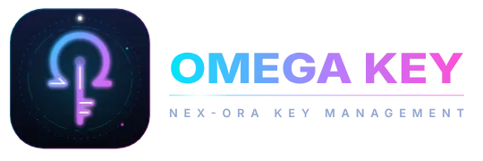
</p>

The kit in [`assets/omega-key-assets/`](./assets/omega-key-assets) ships its own [`README.md`](./assets/omega-key-assets/README.md) and a self-contained gallery, [`preview.html`](./assets/omega-key-assets/preview.html).

- `svg/`: animated vector sources (CSS animation, respects `prefers-reduced-motion`, no external fonts or scripts).
- `webp/`: `name.webp` is a crisp static render and `name-animated.webp` is a 6 s seamless loop.
- `favicon.ico`, `favicon-32.png`, `favicon-192.png`: the favicon set.

**Identity marks**

<table align="center">
  <tr>
    <td align="center"><br /><sub><code>logo.svg</code></sub></td>
    <td align="center"><br /><sub><code>logo-mark.svg</code></sub></td>
    <td align="center"><br /><sub><code>readme-icon.svg</code></sub></td>
  </tr>
</table>

**Key families and states** (animated WebP, 6 s loops)

<table align="center">
  <tr>
    <td align="center">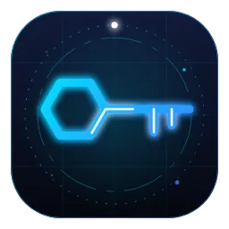<br /><sub><b>License</b> · cyan</sub></td>
    <td align="center"><br /><sub><b>Reader</b> · violet</sub></td>
    <td align="center"><br /><sub><b>Other</b> · amber</sub></td>
  </tr>
  <tr>
    <td align="center">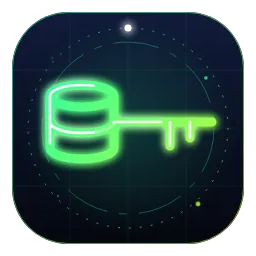<br /><sub><b>Database</b> · green</sub></td>
    <td align="center">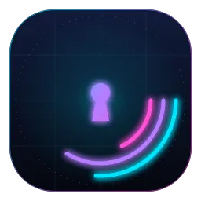<br /><sub><b>Generating</b> · loader</sub></td>
    <td align="center">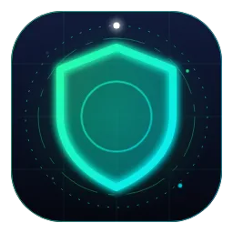<br /><sub><b>Verified</b> · success</sub></td>
  </tr>
</table>

**Divider and mark variants**

<table align="center">
  <tr>
    <td align="center" colspan="2"><br /><sub><code>divider-animated.webp</code></sub></td>
  </tr>
  <tr>
    <td align="center">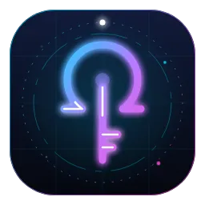<br /><sub><code>logo-mark-animated.webp</code></sub></td>
    <td align="center">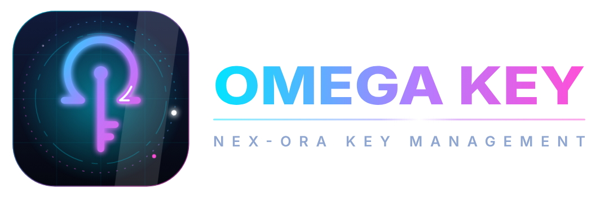<br /><sub><code>logo.webp</code> (static)</sub></td>
  </tr>
</table>

**Favicon set**

<table align="center">
  <tr>
    <td align="center"><br /><sub><code>favicon.svg</code></sub></td>
    <td align="center">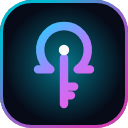<br /><sub><code>favicon.webp</code></sub></td>
    <td align="center"><br /><sub><code>favicon-32.png</code></sub></td>
    <td align="center">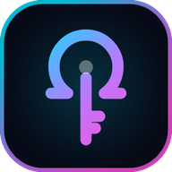<br /><sub><code>favicon-192.png</code></sub></td>
    <td align="center"><a href="./assets/omega-key-assets/favicon.ico"></a><br /><sub><a href="./assets/omega-key-assets/favicon.ico"><code>favicon.ico</code></a><br />16 · 32 · 48 · 64 px</sub></td>
  </tr>
</table>

<details>
<summary><b>Format matrix: every icon as SVG, static WebP, and animated WebP</b></summary>

<table>
  <tr><th>Asset</th><th>SVG (animated vector)</th><th>WebP (static render)</th><th>WebP (animated, 6 s loop)</th></tr>
  <tr>
    <td><b>logo</b></td>
    <td align="center"><br /><sub><code>logo.svg</code></sub></td>
    <td align="center"><br /><sub><code>logo.webp</code></sub></td>
    <td align="center"><br /><sub><code>logo-animated.webp</code></sub></td>
  </tr>
  <tr>
    <td><b>logo-mark</b></td>
    <td align="center"><br /><sub><code>logo-mark.svg</code></sub></td>
    <td align="center">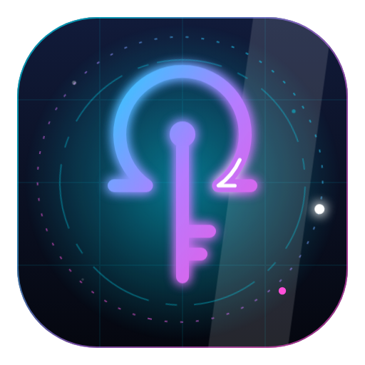<br /><sub><code>logo-mark.webp</code></sub></td>
    <td align="center"><br /><sub><code>logo-mark-animated.webp</code></sub></td>
  </tr>
  <tr>
    <td><b>readme-icon</b></td>
    <td align="center"><br /><sub><code>readme-icon.svg</code></sub></td>
    <td align="center">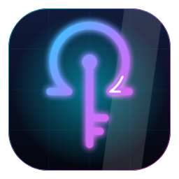<br /><sub><code>readme-icon.webp</code></sub></td>
    <td align="center">—</td>
  </tr>
  <tr>
    <td><b>license-key</b></td>
    <td align="center"><br /><sub><code>license-key.svg</code></sub></td>
    <td align="center">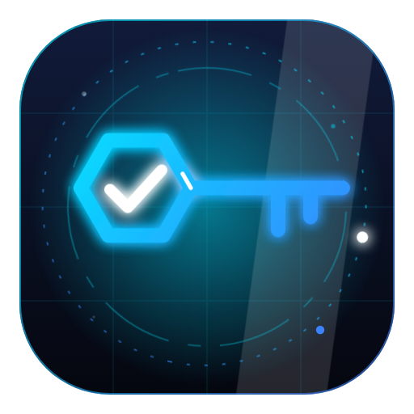<br /><sub><code>license-key.webp</code></sub></td>
    <td align="center"><br /><sub><code>license-key-animated.webp</code></sub></td>
  </tr>
  <tr>
    <td><b>reader-key</b></td>
    <td align="center"><br /><sub><code>reader-key.svg</code></sub></td>
    <td align="center">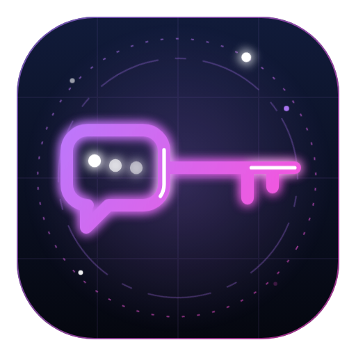<br /><sub><code>reader-key.webp</code></sub></td>
    <td align="center"><br /><sub><code>reader-key-animated.webp</code></sub></td>
  </tr>
  <tr>
    <td><b>other-key</b></td>
    <td align="center"><br /><sub><code>other-key.svg</code></sub></td>
    <td align="center">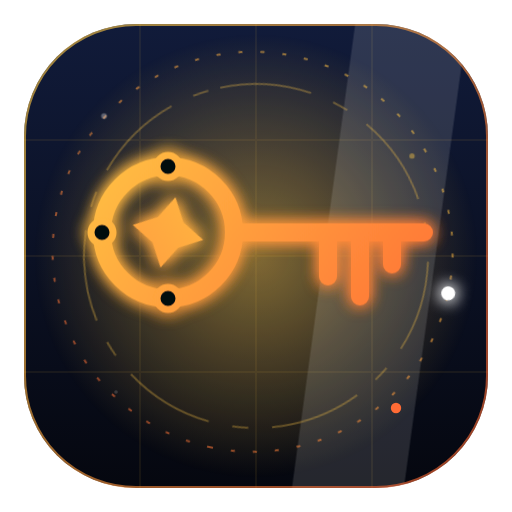<br /><sub><code>other-key.webp</code></sub></td>
    <td align="center"><br /><sub><code>other-key-animated.webp</code></sub></td>
  </tr>
  <tr>
    <td><b>database-key</b></td>
    <td align="center"><br /><sub><code>database-key.svg</code></sub></td>
    <td align="center">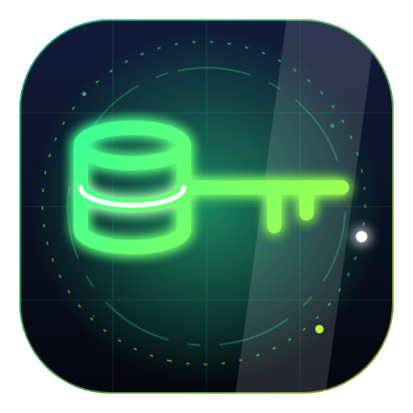<br /><sub><code>database-key.webp</code></sub></td>
    <td align="center"><br /><sub><code>database-key-animated.webp</code></sub></td>
  </tr>
  <tr>
    <td><b>key-generating</b></td>
    <td align="center"><br /><sub><code>key-generating.svg</code></sub></td>
    <td align="center">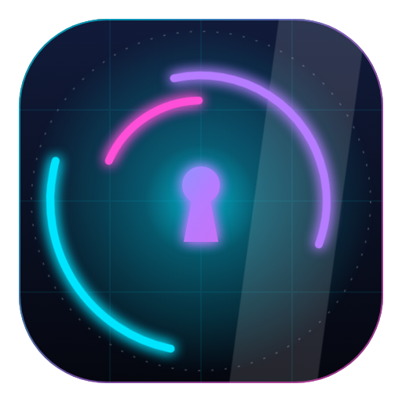<br /><sub><code>key-generating.webp</code></sub></td>
    <td align="center"><br /><sub><code>key-generating-animated.webp</code></sub></td>
  </tr>
  <tr>
    <td><b>key-verified</b></td>
    <td align="center"><br /><sub><code>key-verified.svg</code></sub></td>
    <td align="center">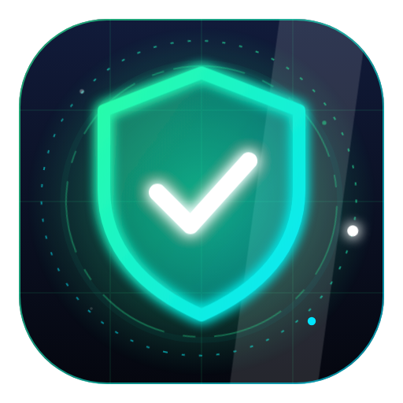<br /><sub><code>key-verified.webp</code></sub></td>
    <td align="center"><br /><sub><code>key-verified-animated.webp</code></sub></td>
  </tr>
  <tr>
    <td><b>favicon</b></td>
    <td align="center"><br /><sub><code>favicon.svg</code></sub></td>
    <td align="center"><br /><sub><code>favicon.webp</code></sub></td>
    <td align="center">—</td>
  </tr>
  <tr>
    <td><b>divider</b></td>
    <td align="center"><br /><sub><code>divider.svg</code></sub></td>
    <td align="center"><br /><sub><code>divider.webp</code></sub></td>
    <td align="center"><br /><sub><code>divider-animated.webp</code></sub></td>
  </tr>
</table>

</details>

### Using the Assets

```html
<!-- Hero banner -->
<p align="center"></p>

<!-- Heading icon -->
<h1> Project name</h1>

<!-- Section divider -->
<p align="center"></p>

<!-- Web favicon for the dashboard -->
<link rel="icon" href="/favicon.svg" type="image/svg+xml">
<link rel="alternate icon" href="/favicon.ico">
```

> [!TIP]
> Use forward slashes and a `./` prefix in every relative path (`./assets/effect/...`), and URL-encode spaces (`NexOra%20Database%20Key%20Gen.html`). Backslash paths break on GitHub. CSS and SMIL animations inside an SVG run when it is embedded with ``; scripts never do.

### Complete Asset Index

All **42 files** shipped in `assets/` are listed here and linked.

<details>
<summary><b>Show the complete asset index (42 files)</b></summary>

| File | Format | Dimensions | Size | Role |
|---|---|---|---|---|
| [`assets/effect/ultra-universal-keygen-logo-v3.svg`](./assets/effect/ultra-universal-keygen-logo-v3.svg) | SVG | 640 × 640 | 15.1 KB | ★ Hero emblem · Key Forge section · footer |
| [`assets/effect/ultra-universal-keygen.svg`](./assets/effect/ultra-universal-keygen.svg) | SVG | 960 × 600 | 11.9 KB | ★ Hero banner · interactive key-forge concept demo |
| [`assets/branding/NexOra Database Key Gen.html`](./assets/branding/NexOra%20Database%20Key%20Gen.html) | HTML | — | 14.5 KB | Standalone client-side key-forge page |
| [`assets/branding/nexora-keygen-banner.svg`](./assets/branding/nexora-keygen-banner.svg) | SVG | 1500 × 500 | 5.9 KB | Brand banner (Overview) |
| [`assets/branding/nexora-keygen-favicon.svg`](./assets/branding/nexora-keygen-favicon.svg) | SVG | 64 × 64 | 0.9 KB | Brand favicon tile (hero row) |
| [`assets/branding/nexora-keygen-logo.svg`](./assets/branding/nexora-keygen-logo.svg) | SVG | 240 × 240 | 9.3 KB | Brand logo (hero row) |
| [`assets/omega-key-assets/favicon-192.png`](./assets/omega-key-assets/favicon-192.png) | PNG | 192 × 192 | 29.5 KB | Favicon, 192 px PNG |
| [`assets/omega-key-assets/favicon-32.png`](./assets/omega-key-assets/favicon-32.png) | PNG | 32 × 32 | 2.2 KB | Favicon, 32 px PNG |
| [`assets/omega-key-assets/favicon.ico`](./assets/omega-key-assets/favicon.ico) | ICO | 16–64 px | 12.7 KB | Multi-size favicon (16/32/48/64 px) |
| [`assets/omega-key-assets/preview.html`](./assets/omega-key-assets/preview.html) | HTML | — | 58.3 KB | Self-contained asset gallery (11 inline SVGs) |
| [`assets/omega-key-assets/README.md`](./assets/omega-key-assets/README.md) | MD | — | 0.8 KB | Asset kit documentation |
| [`assets/omega-key-assets/svg/database-key.svg`](./assets/omega-key-assets/svg/database-key.svg) | SVG | 256 × 256 | 4.2 KB | Database key icon (green): animated vector |
| [`assets/omega-key-assets/svg/divider.svg`](./assets/omega-key-assets/svg/divider.svg) | SVG | 800 × 20 | 2.5 KB | Section divider: animated vector |
| [`assets/omega-key-assets/svg/favicon.svg`](./assets/omega-key-assets/svg/favicon.svg) | SVG | 64 × 64 | 2.5 KB | Favicon: animated vector |
| [`assets/omega-key-assets/svg/key-generating.svg`](./assets/omega-key-assets/svg/key-generating.svg) | SVG | 256 × 256 | 3.7 KB | Key-generating loader state: animated vector |
| [`assets/omega-key-assets/svg/key-verified.svg`](./assets/omega-key-assets/svg/key-verified.svg) | SVG | 256 × 256 | 4.0 KB | Key-verified success state: animated vector |
| [`assets/omega-key-assets/svg/license-key.svg`](./assets/omega-key-assets/svg/license-key.svg) | SVG | 256 × 256 | 4.1 KB | License key icon (cyan): animated vector |
| [`assets/omega-key-assets/svg/logo-mark.svg`](./assets/omega-key-assets/svg/logo-mark.svg) | SVG | 256 × 256 | 4.1 KB | OMEGA KEY logo mark: animated vector |
| [`assets/omega-key-assets/svg/logo.svg`](./assets/omega-key-assets/svg/logo.svg) | SVG | 720 × 240 | 5.1 KB | OMEGA KEY wordmark logo: animated vector |
| [`assets/omega-key-assets/svg/other-key.svg`](./assets/omega-key-assets/svg/other-key.svg) | SVG | 256 × 256 | 4.3 KB | Other / custom key icon (amber): animated vector |
| [`assets/omega-key-assets/svg/reader-key.svg`](./assets/omega-key-assets/svg/reader-key.svg) | SVG | 256 × 256 | 4.4 KB | Reader key icon (violet): animated vector |
| [`assets/omega-key-assets/svg/readme-icon.svg`](./assets/omega-key-assets/svg/readme-icon.svg) | SVG | 128 × 128 | 3.5 KB | README heading icon: animated vector |
| [`assets/omega-key-assets/webp/database-key-animated.webp`](./assets/omega-key-assets/webp/database-key-animated.webp) | WEBP | 256 × 256 | 382.7 KB | Database key icon (green): animated 6 s loop |
| [`assets/omega-key-assets/webp/database-key.webp`](./assets/omega-key-assets/webp/database-key.webp) | WEBP | 512 × 512 | 133.6 KB | Database key icon (green): static render |
| [`assets/omega-key-assets/webp/divider-animated.webp`](./assets/omega-key-assets/webp/divider-animated.webp) | WEBP | 800 × 20 | 86.2 KB | Section divider: animated 6 s loop |
| [`assets/omega-key-assets/webp/divider.webp`](./assets/omega-key-assets/webp/divider.webp) | WEBP | 1600 × 40 | 6.9 KB | Section divider: static render |
| [`assets/omega-key-assets/webp/favicon.webp`](./assets/omega-key-assets/webp/favicon.webp) | WEBP | 128 × 128 | 9.9 KB | Favicon: static render |
| [`assets/omega-key-assets/webp/key-generating-animated.webp`](./assets/omega-key-assets/webp/key-generating-animated.webp) | WEBP | 256 × 256 | 281.1 KB | Key-generating loader state: animated 6 s loop |
| [`assets/omega-key-assets/webp/key-generating.webp`](./assets/omega-key-assets/webp/key-generating.webp) | WEBP | 512 × 512 | 127.9 KB | Key-generating loader state: static render |
| [`assets/omega-key-assets/webp/key-verified-animated.webp`](./assets/omega-key-assets/webp/key-verified-animated.webp) | WEBP | 256 × 256 | 402.9 KB | Key-verified success state: animated 6 s loop |
| [`assets/omega-key-assets/webp/key-verified.webp`](./assets/omega-key-assets/webp/key-verified.webp) | WEBP | 512 × 512 | 135.3 KB | Key-verified success state: static render |
| [`assets/omega-key-assets/webp/license-key-animated.webp`](./assets/omega-key-assets/webp/license-key-animated.webp) | WEBP | 256 × 256 | 348.5 KB | License key icon (cyan): animated 6 s loop |
| [`assets/omega-key-assets/webp/license-key.webp`](./assets/omega-key-assets/webp/license-key.webp) | WEBP | 512 × 512 | 120.0 KB | License key icon (cyan): static render |
| [`assets/omega-key-assets/webp/logo-animated.webp`](./assets/omega-key-assets/webp/logo-animated.webp) | WEBP | 540 × 180 | 678.5 KB | OMEGA KEY wordmark logo: animated 6 s loop |
| [`assets/omega-key-assets/webp/logo-mark-animated.webp`](./assets/omega-key-assets/webp/logo-mark-animated.webp) | WEBP | 256 × 256 | 363.5 KB | OMEGA KEY logo mark: animated 6 s loop |
| [`assets/omega-key-assets/webp/logo-mark.webp`](./assets/omega-key-assets/webp/logo-mark.webp) | WEBP | 512 × 512 | 129.5 KB | OMEGA KEY logo mark: static render |
| [`assets/omega-key-assets/webp/logo.webp`](./assets/omega-key-assets/webp/logo.webp) | WEBP | 1080 × 360 | 90.4 KB | OMEGA KEY wordmark logo: static render |
| [`assets/omega-key-assets/webp/other-key-animated.webp`](./assets/omega-key-assets/webp/other-key-animated.webp) | WEBP | 256 × 256 | 396.0 KB | Other / custom key icon (amber): animated 6 s loop |
| [`assets/omega-key-assets/webp/other-key.webp`](./assets/omega-key-assets/webp/other-key.webp) | WEBP | 512 × 512 | 136.4 KB | Other / custom key icon (amber): static render |
| [`assets/omega-key-assets/webp/reader-key-animated.webp`](./assets/omega-key-assets/webp/reader-key-animated.webp) | WEBP | 256 × 256 | 323.9 KB | Reader key icon (violet): animated 6 s loop |
| [`assets/omega-key-assets/webp/reader-key.webp`](./assets/omega-key-assets/webp/reader-key.webp) | WEBP | 512 × 512 | 120.3 KB | Reader key icon (violet): static render |
| [`assets/omega-key-assets/webp/readme-icon.webp`](./assets/omega-key-assets/webp/readme-icon.webp) | WEBP | 256 × 256 | 39.6 KB | README heading icon: static render |

</details>

<p align="center"></p>

## Configuration

NexOra uses **environment-based configuration** across eight categories: application · database · authentication · security · API · logging · deployment · runtime.

### Environment Variables

Create a local `.env` from `.env.example`. **Never commit the resulting `.env`.**

| Variable | Required status in the documentation | Purpose |
|---|---|---|
| `DATABASE_URL` | Required | Direct PostgreSQL connection string to the Supabase pooler; use `sslmode=require`. |
| `SECRET_KEY` | Required | Flask cryptographic secret; minimum 32 characters, generated securely. |
| `KEY_PEPPER` | Required | Server-side HMAC pepper for key and token digests; minimum 32 characters. |
| `ADMIN_EMAIL` | Required | Super administrator email address. |
| `ADMIN_PASSWORD_HASH` | Required | Argon2id hash of the administrator password. |
| `SUPABASE_URL` | Required for Reader activation | Supabase project URL; activation fails closed if missing. |
| `SUPABASE_SERVICE_ROLE_KEY` | Optional/paired | Server-side Supabase service-role JWT; never sent to a client. |
| `APP_ENV` | Optional | `production` (default), `staging`, or `development`. |
| `COOKIE_SECURE` | Optional | `true` in production (HTTPS required); `false` only for local testing. |
| `TEST_DATABASE_URL` | Recommended for tests | Disposable database that local tests should point at. |

```env
# .env (example shape only: use your own values and never commit this file)
APP_ENV=production
COOKIE_SECURE=true
DATABASE_URL=postgresql://<user>:<password>@<pooler-host>:<port>/<database>?sslmode=require
SECRET_KEY=<random-string-of-32-or-more-characters>
KEY_PEPPER=<a-different-random-string-of-32-or-more-characters>
ADMIN_EMAIL=<admin-email-address>
ADMIN_PASSWORD_HASH=<argon2id-hash>
SUPABASE_URL=https://<project-ref>.supabase.co
```

```bash
# Generate a strong random secret (run once per secret)
python -c "import secrets; print(secrets.token_urlsafe(48))"
```

> [!WARNING]
> **Production rule:** do not use development credentials, disable secure cookies, or weaken authentication controls in a public deployment. Debug mode must never be enabled in production. Variable names follow the supplied documentation, so confirm them against your `.env.example`.

### Technology Stack

| Layer | Technology |
|---|---|
| **Backend** | Python · Flask |
| **Database** | PostgreSQL · Supabase PostgreSQL (TLS connection pool via `pg8000`) |
| **Admin interface** | HTML5 · vanilla JavaScript · CSS |
| **Architecture** | Modular backend · database-driven · API-integrated · environment-configured |
| **Development** | Git · Python virtual environments · automated testing (`pytest`, Playwright browser checks) · database migrations |

Actual versions come from the repository's dependency configuration.

### System Requirements

| Recommended development environment | Production environment |
|---|---|
| Windows · Linux · macOS · Python · Git · VS Code · a PostgreSQL-compatible database · a modern browser | A compatible Python runtime · an application server · a PostgreSQL database · secure environment configuration · HTTPS · logging · backup infrastructure |

<p align="center"></p>

## Repository Layout

```text
.
├── backend/                  # Flask application, services, and /api/v1 routes
├── db/migrations/            # Forward-only PostgreSQL migrations (001–011)
├── frontend/                 # Login, dashboard, and /platform console
├── assets/                   # Visual assets
│   ├── effect/               # Hero emblem and key-forge banner
│   ├── branding/             # NexOra brand set and standalone key-forge page
│   └── omega-key-assets/     # OMEGA KEY kit: animation assets served read-only
├── docs/                     # Guides, audits, and delivery reports
├── tests/                    # Automated backend and frontend tests
├── run.py                    # Local development launcher
└── .env.example              # Environment template
```

<p align="center"></p>

## Testing and Quality

```bash
python -m pytest -v
```

Run the suite from the full source repository.

### Test Results

| Suite | Documented result |
|---|---|
| **pytest** | **282 passed, 26 skipped, exit 0**, after the universal transfer, project roles, imported replacement, scheduler, and deletion-preview work. The 26 skips belong to the optional SMS Reader suite. |
| **Responsive audit** (real Chrome, legacy dashboard) | **282 checks across 11 viewports**: login, dashboard, one-time key reveal, modal containment, mobile navigation, reduced motion, and lite mode. |
| **Platform browser smoke** (authenticated) | **35 checks**: login, all 22 views, project creation, export preview, delete-all pre-execution totals, mobile navigation, and the bounded shutdown animation. |

The smoke run is reproducible against the local test database:

```bash
python scripts/platform_browser_smoke.py
```

See the full repository's [`docs/PROJECT_KEY_MANAGEMENT_TEST_REPORT.md`](docs/PROJECT_KEY_MANAGEMENT_TEST_REPORT.md) for the recorded command and test output.

> [!NOTE]
> These figures are reproduced from the previous documentation and were **not re-run** for this README update.

### Test Areas

| Unit | Integration | Security | UI |
|---|---|---|---|
| Key generation · expiration · permissions · validation · project policies | Database · API · project creation · key creation · key deletion · expiration enforcement | Unauthorized requests · cross-project access · invalid key types · expired keys · revoked keys | Navigation · forms · responsive layouts · error states |

<details>
<summary><b>Detailed coverage documented for the full suite</b></summary>

- Core cryptography and configuration security.
- Project-name normalization and Reader Key lifecycle.
- Versioned API behavior and dashboard integration.
- Generate-key, one-key-per-project, activation, auto-delete, hard-delete, and delete-all behavior.
- Project export/import validation, conflict modes, and transaction rollback.
- Permanent project deletion, delete-all blast-radius preview, owner checks, and audit events.
- Custom role CRUD, assignment, escalation guards, and last-owner protection.
- Project-scoped roles, assignment isolation, anti-escalation, and server-side filtering.
- Imported-key replacement preview, duplicate protection, partial failures, one-time reveal, and history.
- Scheduler idempotency, dry-run/status, advisory locking, worker state, and per-job health.
- Webhook SSRF, DNS pinning, redirect rejection, timeouts, and response bounds.
- Frontend CSP and XSS hardening.

</details>

### Quality Requirements

**Correct functionality · database consistency · security · reliability · performance · compatibility · maintainability.** A feature is not complete until its relevant verification has passed.

<p align="center"></p>

## Deployment and Operations

### Deployment Workflow

#### Flowchart 23: Deployment Workflow

*From source code to production, with the documented backup/PITR gate before migrations.*

<p align="center">
  
</p>

<sub>Editable Mermaid source: [ diagram-23.mmd ](./assets/readme-diagrams/source/diagram-23.mmd)</sub>

### Production Configuration

Secure environment variables · production database · HTTPS · an appropriate application server · database migrations · logging · monitoring · backup · recovery. **Debug mode must not be enabled in production.**

### Backup and Recovery

| Backup requirements | Recovery scenarios |
|---|---|
| Regular backups · secure storage · retention policy · backup verification · recovery testing | Database failure · accidental deletion · data corruption · deployment failure · configuration failure |

Project-level backup and restore are covered in [Backup, Import and Replacement](#backup-import-and-replacement).

### Performance and Scalability

NexOra is designed to support growth: efficient database queries · appropriate indexes · pagination · connection management · efficient validation · a responsive UI · controlled API workloads. Unlimited project and key creation means the platform avoids arbitrary application-level limits while respecting infrastructure capacity.

### Compatibility

Compatibility depends on the actual implementation. The intended targets are modern desktop browsers · mobile browsers · a PostgreSQL-compatible database · a compatible Python runtime · external applications using the supported API.

### Operational Checklist

**Before local or staging use**

- [ ] Install the Python dependencies used by the backend and tests.
- [ ] Configure secrets outside source control from `.env.example`.
- [ ] Point local tests at a disposable `TEST_DATABASE_URL`.
- [ ] Confirm the database backup and recovery plan before applying gated migrations.
- [ ] Apply migrations only in the correct environment and in the documented order.
- [ ] Run the full test suite.

**Before production**

- [ ] Use HTTPS and secure cookies.
- [ ] Verify Argon2id, session, CSRF, rate-limit, and HMAC configuration.
- [ ] Confirm RLS policies using a non-owner database role.
- [ ] Confirm no service-role/database secret reaches browser or Reader client code.
- [ ] Test key redemption, duplicate names, revocation, deactivation, deletion, and rollback paths.
- [ ] Approve the backup/PITR migration gate before migrations 005–011.
- [ ] Verify universal key generation, project expiry, hard revocation, RBAC, and webhook signing.
- [ ] Configure scheduled cleanup only after retention requirements are approved.
- [ ] Enable GitHub repository access and default-branch protections.

<p align="center"></p>

## Troubleshooting and FAQ

### Troubleshooting

<table>
  <tr>
    <th>Database connection issues</th>
    <th>Invalid key</th>
  </tr>
  <tr>
    <td valign="top">
      Verify:
      <ul>
        <li>Database URL</li>
        <li>Credentials</li>
        <li>Network</li>
        <li>Database availability</li>
        <li>Connection configuration</li>
      </ul>
    </td>
    <td valign="top">
      Verify:
      <ul>
        <li>The key exists</li>
        <li>Correct project</li>
        <li>Correct key type</li>
        <li>Status</li>
        <li>Expiration</li>
        <li>Project status</li>
        <li>Permissions</li>
      </ul>
    </td>
  </tr>
  <tr>
    <th>Expired project</th>
    <th>Deployment issues</th>
  </tr>
  <tr>
    <td valign="top">
      Verify:
      <ul>
        <li>Project expiration</li>
        <li>Project status</li>
        <li>Never-expiring configuration</li>
        <li>Server time</li>
      </ul>
    </td>
    <td valign="top">
      Verify:
      <ul>
        <li>Dependencies</li>
        <li>Runtime</li>
        <li>Environment variables</li>
        <li>Database connectivity</li>
        <li>Migration status</li>
        <li>Application startup logs</li>
      </ul>
    </td>
  </tr>
</table>

### Frequently Asked Questions

<details>
<summary><b>What is NexOra?</b></summary>

A universal database-driven key and project management platform.

</details>

<details>
<summary><b>Why is NexOra universal?</b></summary>

It combines multiple key types and project management into one platform.

</details>

<details>
<summary><b>Can NexOra manage unlimited projects?</b></summary>

The design supports unlimited project creation, subject to infrastructure capacity.

</details>

<details>
<summary><b>Can NexOra generate unlimited keys?</b></summary>

The design supports unlimited key generation, subject to database and infrastructure capacity.

</details>

<details>
<summary><b>Can a project or a key never expire?</b></summary>

Yes. Permanent project and permanent key policies are supported by the intended design, and permanence never bypasses suspension, revocation, permissions, or security policies.

</details>

<details>
<summary><b>Can different key types have different permissions?</b></summary>

Yes. Key-type isolation is a core architectural requirement.

</details>

<details>
<summary><b>Can revoked keys be deleted?</b></summary>

Yes. The intended system supports revocation and permanent deletion.

</details>

<details>
<summary><b>Does NexOra include the Reader App?</b></summary>

No. The Reader App is a separate application and repository.

</details>

<details>
<summary><b>Does NexOra use a database?</b></summary>

Yes. PostgreSQL-compatible database infrastructure is used (Supabase PostgreSQL is documented).

</details>

<details>
<summary><b>Can external applications integrate?</b></summary>

The platform is designed for API integration through the versioned REST API.

</details>

<p align="center"></p>

## Roadmap

### Development Phases

| Phase | Scope | Status per the current documentation |
|---|---|---|
| **1 · Core Infrastructure** | Application architecture · database · authentication · project management · administrative dashboard | ✅ Documented as delivered |
| **2 · Universal Key System** | Key generation · key management · key types · project association · validation | ✅ Documented as delivered |
| **3 · Lifecycle** | Expiration · permanent authorization · revocation · permanent deletion | ✅ Expiration, revocation, and deletion documented · 🔎 verify the permanent-authorization policy |
| **4 · Security** | Project isolation · permission system · key-type isolation · rate limiting · security testing | ✅ RBAC, ceilings, CSRF, RLS, and SSRF tests documented · 🔎 verify per deployment |
| **5 · API** | Integration API · API documentation · structured responses · integration testing | ✅ REST v1 and OpenAPI document |
| **6 · UI/UX** | Dashboard · responsive interface · animations · themes · accessibility | ✅ Dashboard, responsive audit, animations · 🔜 themes and accessibility |
| **7 · Infrastructure** | Deployment · monitoring · backup · recovery | 🚧 Checklists and scheduler documented · production approval pending |

> [!NOTE]
> Status reflects what this documentation describes. It is not a production-readiness certification; see [Known Boundaries](#known-boundaries).

### Future Vision

NexOra is intended to evolve into a universal authorization-management ecosystem. Potential capabilities: advanced key-type registry · project policy templates · advanced authorization configuration · improved monitoring · expanded API · multi-administrator support · role-based access management · advanced audit records · integration management · improved analytics · additional database support · advanced deployment automation.

Future capabilities must be introduced **without compromising existing project isolation or authorization boundaries**.

<p align="center"></p>

## Governance and Policy

### Owner-Controlled Repository Policy

| | |
|---|---|
| **Repository classification** | Owner-controlled, proprietary project |
| **Project builder / stated rights holder** | Shajeduzzaman Enan |
| **Official change authorization** | Explicit written approval from the project owner |
| **Default contribution status** | Not authorized unless the owner grants permission |

No contributor is granted permission by this README or by the public availability of the repository to modify, publish, redistribute, sublicense, or create derivative versions of the official project. Any permitted contribution must be explicitly authorized by the rights holder in writing and processed through the repository's configured access controls. See [`LICENSE`](LICENSE) for the full proprietary terms.

> [!IMPORTANT]
> **Important technical distinction.** A README notice, `CODEOWNERS`, or a proprietary `LICENSE` file does not by itself prevent someone from editing a local copy or a fork. GitHub access permissions and branch/ruleset enforcement must be configured by the repository owner. A public repository can still be forked and changed independently; these controls protect the official repository, not every copy on the internet.

See [`docs/REPOSITORY_PROTECTION.md`](docs/REPOSITORY_PROTECTION.md) for the required GitHub settings and activation checklist. Replace `@OWNER_GITHUB_USERNAME` in `.github/CODEOWNERS` before relying on code-owner review.

### Contributing

Contributions are accepted **only with the owner's explicit written authorization** (see the policy above). Authorized contributions must preserve the architectural principles of NexOra:

- Follow the existing architecture.
- Maintain project isolation and key-type isolation.
- Validate all inputs.
- Write tests and document new functionality.
- Avoid unnecessary changes.
- Review the security implications of every change.

### Security Reporting

Report security vulnerabilities **privately** to the project maintainer, and do not publicly disclose sensitive issues before an appropriate review.

A report should include the **affected component · a description · the impact · reproduction details · a suggested mitigation**. Never include real credentials or sensitive data in public reports.

### Project Governance

Development prioritizes, in order: **1.** Security · **2.** Reliability · **3.** Database integrity · **4.** Authorization correctness · **5.** Backward compatibility · **6.** Maintainability · **7.** User experience · **8.** Extensibility.

<p align="center"></p>

## Known Boundaries

- This repository covers the Admin system and backend API surface; the Android Reader App is separate.
- Migrations 009–011 were applied only to the dedicated local test database, not production.
- External webhook delivery, cross-browser behavior, and production load were not tested. See [`docs/UNIVERSAL_PLATFORM_REPORT.md`](docs/UNIVERSAL_PLATFORM_REPORT.md) for the complete tested/not-tested boundary.
- Test figures are reproduced from the previous documentation and were not re-run for this update.
- The hero banner (`assets/effect/ultra-universal-keygen.svg`) and the `assets/branding/` SVGs animate continuously and do not yet include a `prefers-reduced-motion` rule; the OMEGA KEY kit and the effect emblem do.
- The example API responses and the data-model diagram are illustrative; the migrations and the live OpenAPI document are authoritative.
- This documentation does **not** certify that the deployed system is secure or production-ready. Review the actual source, environment, database policies, and deployment before production use.

<p align="center"></p>

## Legal

### Third-Party Notices

The Admin HTML and the standalone key-forge page (`assets/branding/NexOra Database Key Gen.html`) load the **Orbitron** and **Share Tech Mono** font families from Google Fonts. Those fonts and the Google Fonts service are third-party resources and are not covered by the project's proprietary license. The SVG assets only name fonts in fallback stacks and request nothing externally. The badges at the top of this README are rendered by shields.io. See [`THIRD_PARTY_NOTICES.md`](THIRD_PARTY_NOTICES.md). A complete dependency inventory was not included in the supplied ZIP.

### License

**Copyright (c) 2026 Shajeduzzaman Enan. All rights reserved.**

OMEGA NEX-ORA is distributed under the custom **OMEGA NEX-ORA Proprietary Software and Content License**, available in [`LICENSE`](LICENSE). It is **not an open-source license**. No general permission is granted to copy, modify, publish, redistribute, sublicense, integrate, host, or commercially use the original Project Materials without prior written authorization from the rights holder, except where applicable law provides a non-waivable right.

The license applies only to original materials owned or controlled by the rights holder. Third-party fonts, libraries, services, and other externally owned materials remain subject to their own terms. See [`THIRD_PARTY_NOTICES.md`](THIRD_PARTY_NOTICES.md).

The project identity supplied for this documentation names **Shajeduzzaman Enan** as the builder. The copyright notice is prepared on that basis; before public or commercial release, the named person should confirm that they personally own or are authorized to license all original materials covered by this notice. This document is a practical license draft, not jurisdiction-specific legal advice.

### Acknowledgements

NexOra represents an ongoing effort to build a universal and centralized key-management platform. The project emphasizes modular architecture, secure authorization, database integrity, extensibility, and unified administration.

<p align="center"></p>

<div align="center">


<h3>⚡ NEXORA</h3>

<p>
  <strong>ONE UNIVERSAL PLATFORM.</strong><br />
  <strong>EVERY PROJECT.</strong><br />
  <strong>MULTIPLE KEY TYPES.</strong><br />
  <strong>UNLIMITED POSSIBILITIES.</strong>
</p>

<p>
  NexOra is built around a simple principle:<br />
  <strong>key management should be centralized, authorization should be secure, projects should remain isolated,<br />and the platform should be extensible without unnecessary complexity.</strong>
</p>

<p>One platform · One unified management system · A foundation for every supported key type</p>

<p>
  <sub><strong>OMEGA NEX-ORA · NEXORA DATABASE KEY GENERATOR</strong></sub><br />
  <sub><em>Universal Key Management · Secure Authorization · Centralized Project Control</em></sub><br />
  <sub><em>Secure Keys · Controlled Access · Auditable Operations</em></sub>
</p>

<p><sub>Copyright (c) 2026 Shajeduzzaman Enan. All rights reserved.</sub></p>

<p><a href="#readme-top">↑ Back to top</a></p>

</div>
