# OMEGA KEY - visual assets

- `svg/` animated vector sources (CSS animation, respects `prefers-reduced-motion`, no external fonts or scripts)
- `webp/` `name.webp` = crisp static render, `name-animated.webp` = 6 s seamless loop
- `favicon.ico`, `favicon-32.png`, `favicon-192.png`

```html
<p align="center"></p>
<h1> Project name</h1>


<link rel="icon" href="/favicon.svg" type="image/svg+xml">
<link rel="alternate icon" href="/favicon.ico">
```

Key types: `license-key.svg` (cyan), `reader-key.svg` (violet), `other-key.svg` (amber), `database-key.svg` (green).
States: `key-generating.svg` (loader), `key-verified.svg` (success).
